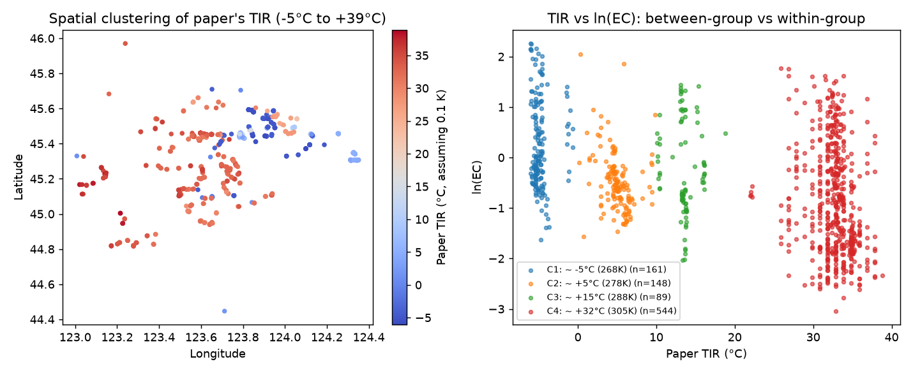
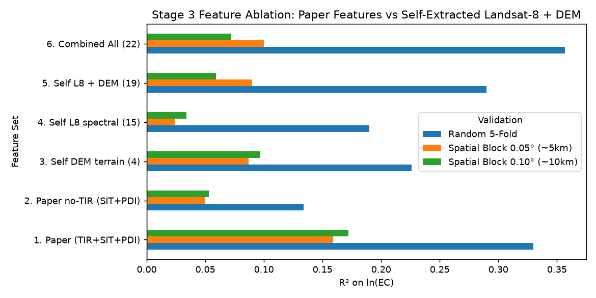

# 松嫩平原西部土壤电导率（EC）遥感估计：空间验证、混杂诊断与自提取特征评估

基于公开实测样本（吉林白城、松原，942 点，$0\text{--}5\text{ cm}$ 表土 $\text{EC}_{1:5}$），复现并审计遥感土壤盐分预测流程，**结合公开 STAC 卫星接口（Microsoft Planetary Computer）独立提取 Landsat-8 裸土期全波段反射率与 Copernicus 30m DEM 地形特征**，系统比较随机划分与空间分块验证下的泛化表现。

数据来源：
- 地面实测样本：Wang et al., 2025, *Scientific Data* 12:1783（[论文](https://www.nature.com/articles/s41597-025-06057-7) / [Zenodo](https://zenodo.org/records/17044261)，MD5 `9c2e663b52c0631ecdb35c5c46d33d2e`）
- 自提取遥感与地形数据：通过 Planetary Computer STAC API 自动拉取 16 景秋收裸土期无云 **Landsat-8 Collection 2 Level-2** 地表反射率及 **Copernicus DEM GLO-30**（无需账号密钥即可复现）

## 快速运行

```powershell
python -m venv .venv
.\.venv\Scripts\pip install -r requirements.txt
.\.venv\Scripts\python src\audit.py                      # 阶段 1：数据审计 -> reports/audit_summary.md
.\.venv\Scripts\python src\baseline.py                   # 阶段 2：基线与空间验证 -> reports/baseline_results.md
.\.venv\Scripts\python src\extract_satellite_features.py # 阶段 3a：STAC 独立提取 L8 + DEM 特征
.\.venv\Scripts\python src\stage3_experiments.py         # 阶段 3b：混杂诊断与特征消融 -> reports/stage3_results.md
```

## 核心发现

### 1. 原数据 `TIR`（热红外亮温）存在跨采样批次的季节温度混杂（Shortcut Learning）
- 原表 `TIR` 数值为 `2671–3120`（即 `267.1 K – 312.0 K`，折合 **`-6 °C` 至 `+39 °C`**），按分布可拆出 **4 个离散温度簇**，对应不同采样年份/批次匹配的卫星过境季节。
- 全样本下 `TIR` 与 $\ln(\text{EC})$ 的相关性（$r = -0.397$）主要源于**不同批次平均盐度与过境季节温差的耦合**（冷季 `-5 °C` 批次平均 $\text{EC} = 2.01\text{ dS/m}$，暖季 `+32 °C` 批次平均 $\text{EC} = 0.77\text{ dS/m}$）；在单一温度批次内部，`TIR` 与 $\ln(\text{EC})$ 相关性接近 **0**。



### 2. 自提取 `Landsat-8 + Copernicus DEM` 特征消融对比（目标：$\ln(\text{EC})$）

| 特征集合 | 随机 5 折 $R^2$ | 0.05°（~5km）空间分块 $R^2$ | 0.10°（~10km）空间分块 $R^2$ | 0.10° 空间分块高盐筛查 ROC-AUC |
|---|---:|---:|---:|---:|
| 原论文光学特征（`SIT + PDI`，去除跨期亮温混杂） | 0.134 | 0.050 | 0.053 | 0.585（Top-20% 命中率 44.7%） |
| 自提取 Copernicus 30m DEM 地形（4 特征） | 0.226 | 0.087 | **0.097** | 0.594（Top-20% 命中率 49.5%） |
| 自提取 Landsat-8 裸土期全波段与指数（15 特征） | 0.190 | 0.024 | 0.034 | 0.601（Top-20% 命中率 53.7%） |
| **自提取 Landsat-8 + DEM 地形（19 特征）** | **0.290** | **0.090** | 0.059 | **0.615（Top-20% 命中率 55.3%）** |
| 原论文 3 特征（`TIR + SIT + PDI`，含季节温差捷径） | 0.330 | 0.159 | 0.172 | 0.707（Top-20% 命中率 63.3%） |
| 全部特征合并（22 特征） | **0.357** | 0.100 | 0.072 | 0.656（Top-20% 命中率 63.8%） |

- **去除季节温差伪相关后**，自提取的 **Landsat-8 + DEM 地形特征（19 维）** 将随机交叉验证 $R^2$ 从原论文光学特征（`SIT + PDI`）的 **0.134 提升至 0.290（提升逾 2 倍）**，空间分块 $R^2$ 从 **0.050 提升至 0.090**。
- **地形比单纯多光谱反射率更具空间外推稳定性**：30m 高程（`dem_elev`，$r = -0.309$）与局地微洼地指数（`dem_tpi_300m`）是仅次于 `TIR` 的最强预测因子。
- **工程边界判断**：在严格未知空间区块上，30m 多光谱遥感对连续 $\text{EC}$ 值的回归能力有限（空间分块 $R^2 \le 0.17$），不宜宣称可做跨区域精确盐度分级；但用于**中重度盐渍化风险区初筛（$\text{EC}_e \ge 8\text{ dS/m}$）**时，自提取特征可在未知空间区块将前 20% 优先采样区的命中率从基准 38.0% 提升至 **55.3%（1.46 倍提升）**。



## 目录结构

```
data/raw/                         原始实测点 CSV（MD5 已校验）
docs/paper_notes.md               原论文方法拆解与复现核查笔记
src/audit.py                      阶段 1：标签审计（缺失、重复坐标分组、偏度、异常值）
src/baseline.py                   阶段 2：基线模型 × 随机/空间分块/跨市留出验证
src/extract_satellite_features.py 阶段 3a：通过 STAC 自动拉取 Copernicus DEM 与 16 景 Landsat-8
src/stage3_experiments.py         阶段 3b：TIR 季节温差混杂诊断、特征消融与高盐风险筛查评估
reports/                          自动生成的 Markdown 实验报告与图表
```
