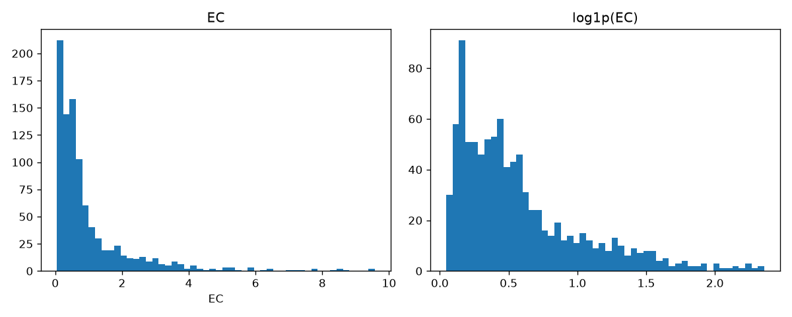
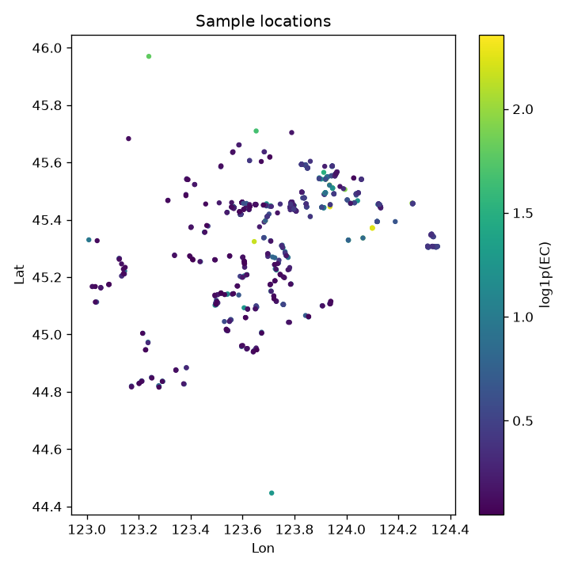
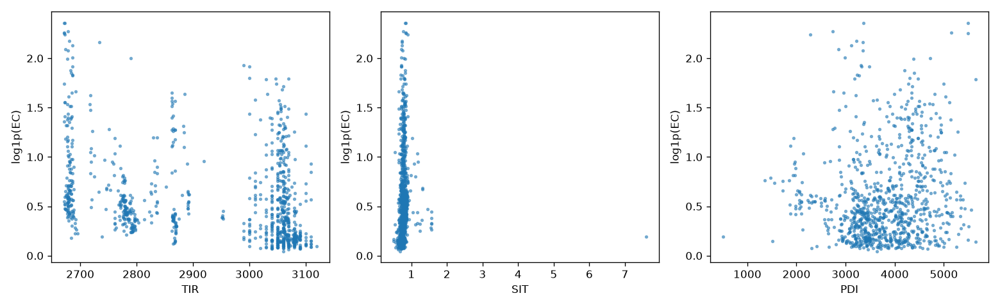

# 数据审计报告

源文件：`data\raw\Soil_EC_sampling_points.csv`，942 行

## 1. 字段与缺失

| 列 | 类型 | 缺失 |
|---|---|---|
| ID | int64 | 0 |
| Lon | float64 | 0 |
| Lat | float64 | 0 |
| Municipal | str | 0 |
| EC | float64 | 0 |
| TIR | float64 | 0 |
| SIT | float64 | 0 |
| PDI | float64 | 0 |

ID 唯一：True；完全重复行：0

## 2. 地区分布

| Municipal   |   n |
|:------------|----:|
| Baicheng    | 853 |
| Songyuan    |  89 |

## 3. 坐标范围

|       |      Lon |      Lat |
|:------|---------:|---------:|
| count | 942      | 942      |
| mean  | 123.739  |  45.3686 |
| std   |   0.2667 |   0.1763 |
| min   | 123.008  |  44.4468 |
| 25%   | 123.566  |  45.3028 |
| 50%   | 123.724  |  45.4425 |
| 75%   | 123.906  |  45.4579 |
| max   | 124.352  |  45.97   |

## 4. 重复坐标

唯一坐标数：939；涉及重复的记录：6

|   ID |     Lon |     Lat | Municipal   |       EC |    TIR |   SIT |     PDI |
|-----:|--------:|--------:|:------------|---------:|-------:|------:|--------:|
|  813 | 123.385 | 45.541  | Baicheng    | 0.245122 | 3050   | 0.754 | 4282.28 |
|  866 | 123.385 | 45.541  | Baicheng    | 0.160896 | 3050   | 0.624 | 3012.59 |
|  275 | 123.558 | 45.445  | Baicheng    | 0.179066 | 3068.5 | 0.743 | 3557.36 |
|  904 | 123.558 | 45.445  | Baicheng    | 0.112029 | 3050   | 0.708 | 3143.78 |
|  556 | 124.119 | 45.3937 | Baicheng    | 1.40635  | 2680   | 0.825 | 3883.65 |
|  573 | 124.119 | 45.3937 | Baicheng    | 0.942707 | 2680   | 0.825 | 3883.65 |

处理：保留全部记录，但以 `location_group` 分组，保证同一坐标不会同时进入训练和测试集。

## 5. 目标变量 EC

| Municipal   |   count |   mean |   std |   min |   25% |   50% |   75% |   max |
|:------------|--------:|-------:|------:|------:|------:|------:|------:|------:|
| Baicheng    |     853 |  1.059 | 1.374 | 0.048 | 0.258 | 0.554 | 1.219 | 9.574 |
| Songyuan    |      89 |  0.652 | 0.411 | 0.074 | 0.44  | 0.623 | 0.83  | 2.591 |

整体偏度：3.04；log1p 后偏度：1.39；非正值数：0

## 6. 特征

|       |      TIR |     SIT |      PDI |
|:------|---------:|--------:|---------:|
| count |  942     | 942     |  942     |
| mean  | 2932.24  |   0.785 | 3794.05  |
| std   |  155.296 |   0.246 |  761.987 |
| min   | 2671     |   0.497 |  501.864 |
| 25%   | 2781     |   0.729 | 3314.01  |
| 50%   | 3040     |   0.771 | 3775.13  |
| 75%   | 3061     |   0.813 | 4337.35  |
| max   | 3120     |   7.601 | 5650.37  |

### 与 EC 的相关系数（Spearman）

|     |    rho |
|:----|-------:|
| TIR | -0.428 |
| SIT |  0.288 |
| PDI |  0.125 |

### 特征间相关（Pearson）

|     |    TIR |    SIT |    PDI |
|:----|-------:|-------:|-------:|
| TIR |  1     | -0.191 |  0.291 |
| SIT | -0.191 |  1     | -0.149 |
| PDI |  0.291 | -0.149 |  1     |

## 7. 离群值（IQR×3，仅报告不删除）

| 列 | 数量 |
|---|---|
| TIR | 0 |
| SIT | 20 |
| PDI | 0 |
| EC | 41 |

## 8. 已知缺口

- 无采样日期/年份、采样深度列 → 暂不能自行重新匹配卫星影像。
- TIR / SIT / PDI 的具体定义与单位需对照原论文确认。
- 仅覆盖吉林白城、松原，不代表黑龙江/内蒙古。

## 图

