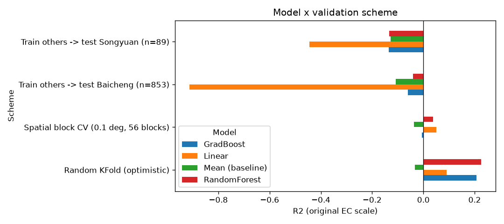
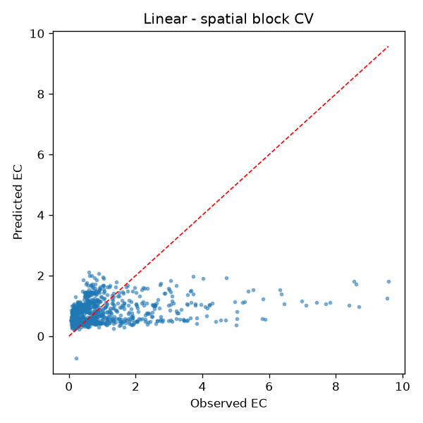

# 基线模型结果

特征：TIR, SIT, PDI；目标：log1p(EC) 训练，指标在 EC 原尺度计算；样本 942。

## 各验证方案

| Scheme                                | Model           |   MAE |   RMSE |     R2 |
|:--------------------------------------|:----------------|------:|-------:|-------:|
| Random KFold (optimistic)             | Mean (baseline) | 0.762 |  1.34  | -0.034 |
| Random KFold (optimistic)             | Linear          | 0.732 |  1.257 |  0.091 |
| Random KFold (optimistic)             | RandomForest    | 0.649 |  1.16  |  0.225 |
| Random KFold (optimistic)             | GradBoost       | 0.665 |  1.172 |  0.208 |
| Spatial block CV (0.1 deg, 56 blocks) | Mean (baseline) | 0.764 |  1.342 | -0.037 |
| Spatial block CV (0.1 deg, 56 blocks) | Linear          | 0.754 |  1.284 |  0.051 |
| Spatial block CV (0.1 deg, 56 blocks) | RandomForest    | 0.75  |  1.293 |  0.037 |
| Spatial block CV (0.1 deg, 56 blocks) | GradBoost       | 0.777 |  1.322 | -0.006 |
| Train others -> test Songyuan (n=89)  | Mean (baseline) | 0.336 |  0.434 | -0.128 |
| Train others -> test Songyuan (n=89)  | Linear          | 0.402 |  0.491 | -0.445 |
| Train others -> test Songyuan (n=89)  | RandomForest    | 0.277 |  0.435 | -0.134 |
| Train others -> test Songyuan (n=89)  | GradBoost       | 0.324 |  0.436 | -0.136 |
| Train others -> test Baicheng (n=853) | Mean (baseline) | 0.779 |  1.445 | -0.108 |
| Train others -> test Baicheng (n=853) | Linear          | 0.79  |  1.898 | -0.912 |
| Train others -> test Baicheng (n=853) | RandomForest    | 0.727 |  1.4   | -0.04  |
| Train others -> test Baicheng (n=853) | GradBoost       | 0.731 |  1.413 | -0.06  |

## 分段误差（Spatial block CV (0.1 deg, 56 blocks)，Linear，按 EC 四分位）

| bin             |   n |   MAE |   Bias |
|:----------------|----:|------:|-------:|
| (0.0467, 0.265] | 236 | 0.389 |  0.381 |
| (0.265, 0.558]  | 235 | 0.421 |  0.404 |
| (0.558, 1.135]  | 235 | 0.384 |  0.138 |
| (1.135, 9.574]  | 236 | 1.819 | -1.799 |

## 图

