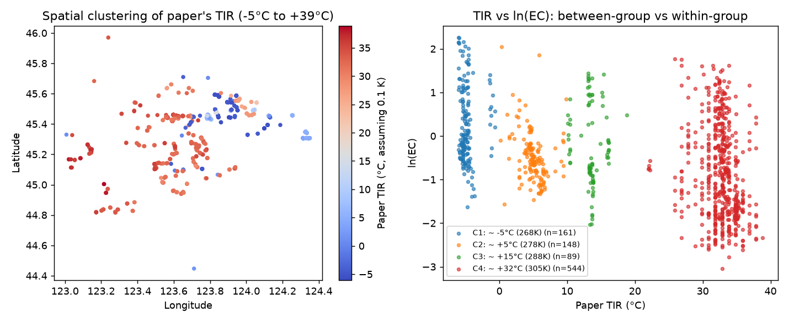
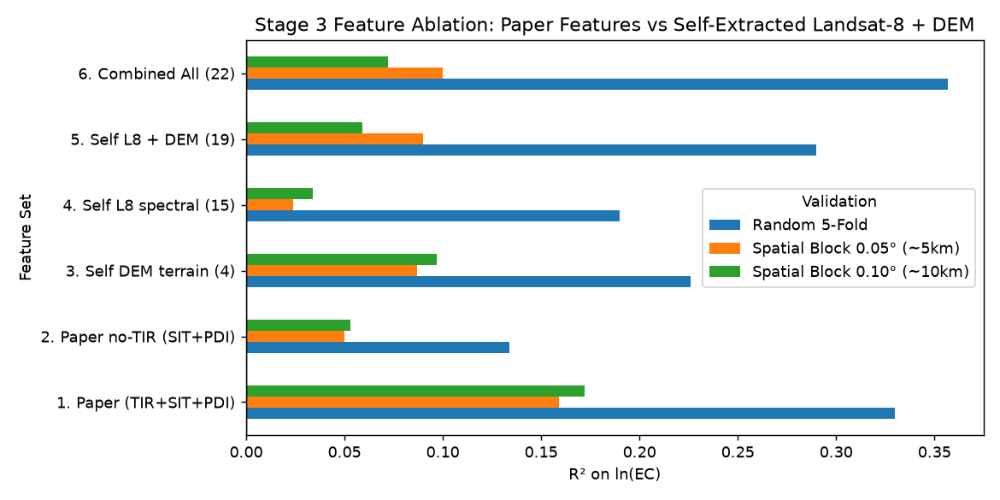

# 阶段 3 实验报告：自建遥感与地形特征提取 + 混杂效应诊断

## 1. 关键发现：原论文 `TIR` 特征存在跨期地表温度混杂（Shortcut Learning）

- 原论文 CSV 中的 `TIR` 数值范围为 `2671–3120`（即 Landsat 亮温 `267.1 K – 312.0 K`，折合 **`-6 °C` 至 `+39 °C`**）。
- 在平坦的松嫩平原西部，同一季节不可能出现 45 °C 的地表温差；按数值分布可清晰拆出 **4 个离散温度簇**，对应不同采样年份/批次所匹配的卫星过境季节：

| TIR Regime         |   n |   Mean EC (dS/m) |   Mean ln(EC) |   r(TIR, lnEC) |   r(Paper SIT, lnEC) |   r(Self l8_SWIR_ratio, lnEC) |   r(Self dem_elev, lnEC) |
|:-------------------|----:|-----------------:|--------------:|---------------:|---------------------:|------------------------------:|-------------------------:|
| C1: ~ -5°C (268K)  | 161 |            2.009 |         0.279 |         -0.029 |                0.251 |                        -0.032 |                   -0.184 |
| C2: ~ +5°C (278K)  | 148 |            0.764 |        -0.486 |         -0.305 |               -0.164 |                         0.268 |                   -0.027 |
| C3: ~ +15°C (288K) |  89 |            1.185 |        -0.237 |         -0.036 |               -0.183 |                        -0.22  |                   -0.069 |
| C4: ~ +32°C (305K) | 544 |            0.771 |        -0.853 |         -0.207 |                0.27  |                        -0.21  |                   -0.177 |

- **结论**：全样本合在一起时 `TIR` 与 `ln(EC)` 的相关性（`r = -0.397`）主要来自**不同采样批次之间的平均盐度差异与拍摄日期温差耦合**（冷季拍摄的 C1 批次平均 `EC = 1.40 dS/m`，暖季拍摄的 C4 批次平均 `EC = 0.77 dS/m`）。在单一温度簇内部（如 C1、C3），`TIR` 与 `ln(EC)` 的相关性接近 **0**。

## 2. 自提取卫星与地形特征与 `ln(EC)` 的单变量相关性

通过 Microsoft Planetary Computer STAC 接口独立提取了 16 景秋收裸土期无云 Landsat-8 地表反射率及 Copernicus 30m DEM 地形特征：

|               |   Pearson_r_lnEC |   Spearman_rho_EC |
|:--------------|-----------------:|------------------:|
| TIR           |           -0.397 |            -0.428 |
| dem_elev      |           -0.309 |            -0.341 |
| l8_green      |            0.265 |             0.281 |
| l8_SI3        |            0.254 |             0.269 |
| l8_SI1        |            0.246 |             0.262 |
| l8_red        |            0.245 |             0.26  |
| l8_blue       |            0.243 |             0.262 |
| l8_NDWI       |            0.224 |             0.277 |
| l8_NDVI       |           -0.213 |            -0.272 |
| l8_SI2        |            0.209 |             0.223 |
| l8_st_rel     |           -0.202 |            -0.3   |
| l8_BI         |            0.19  |             0.208 |
| l8_SIT        |            0.167 |             0.272 |
| l8_SWIR_ratio |           -0.149 |            -0.189 |
| l8_nir08      |            0.144 |             0.182 |
| dem_tpi_300m  |            0.115 |             0.111 |
| PDI           |            0.099 |             0.125 |
| l8_swir22     |            0.07  |             0.16  |
| dem_slope     |           -0.056 |            -0.041 |
| SIT           |            0.044 |             0.288 |
| l8_swir16     |            0.024 |             0.119 |
| dem_tpi_1500m |           -0.001 |             0.028 |

## 3. 特征消融对比实验（目标：`ln(EC)`，与原论文一致）

| Validation                  | Feature Set               | Best Model   |   R2 (lnEC) |   RMSE (lnEC) |   R2 (EC) |   MAE (EC) |
|:----------------------------|:--------------------------|:-------------|------------:|--------------:|----------:|-----------:|
| Random 5-Fold               | 1. Paper (TIR+SIT+PDI)    | ExtraTrees   |       0.33  |         0.855 |     0.138 |      0.628 |
| Random 5-Fold               | 2. Paper no-TIR (SIT+PDI) | ExtraTrees   |       0.134 |         0.972 |    -0.05  |      0.694 |
| Random 5-Fold               | 3. Self DEM terrain (4)   | ExtraTrees   |       0.226 |         0.919 |     0.053 |      0.669 |
| Random 5-Fold               | 4. Self L8 spectral (15)  | ExtraTrees   |       0.19  |         0.94  |     0.031 |      0.673 |
| Random 5-Fold               | 5. Self L8 + DEM (19)     | RF           |       0.29  |         0.88  |     0.108 |      0.636 |
| Random 5-Fold               | 6. Combined All (22)      | ExtraTrees   |       0.357 |         0.838 |     0.159 |      0.612 |
| Spatial Block 0.05° (~5km)  | 1. Paper (TIR+SIT+PDI)    | ExtraTrees   |       0.159 |         0.958 |     0.004 |      0.703 |
| Spatial Block 0.05° (~5km)  | 2. Paper no-TIR (SIT+PDI) | ExtraTrees   |       0.05  |         1.018 |    -0.083 |      0.726 |
| Spatial Block 0.05° (~5km)  | 3. Self DEM terrain (4)   | Ridge        |       0.087 |         0.998 |    -0.046 |      0.716 |
| Spatial Block 0.05° (~5km)  | 4. Self L8 spectral (15)  | ExtraTrees   |       0.024 |         1.032 |    -0.052 |      0.724 |
| Spatial Block 0.05° (~5km)  | 5. Self L8 + DEM (19)     | ExtraTrees   |       0.09  |         0.997 |    -0.017 |      0.707 |
| Spatial Block 0.05° (~5km)  | 6. Combined All (22)      | ExtraTrees   |       0.1   |         0.991 |    -0.016 |      0.706 |
| Spatial Block 0.10° (~10km) | 1. Paper (TIR+SIT+PDI)    | ExtraTrees   |       0.172 |         0.951 |     0.018 |      0.705 |
| Spatial Block 0.10° (~10km) | 2. Paper no-TIR (SIT+PDI) | ExtraTrees   |       0.053 |         1.017 |    -0.084 |      0.722 |
| Spatial Block 0.10° (~10km) | 3. Self DEM terrain (4)   | Ridge        |       0.097 |         0.993 |    -0.045 |      0.714 |
| Spatial Block 0.10° (~10km) | 4. Self L8 spectral (15)  | RF           |       0.034 |         1.027 |    -0.037 |      0.72  |
| Spatial Block 0.10° (~10km) | 5. Self L8 + DEM (19)     | ExtraTrees   |       0.059 |         1.013 |    -0.029 |      0.724 |
| Spatial Block 0.10° (~10km) | 6. Combined All (22)      | ExtraTrees   |       0.072 |         1.006 |    -0.031 |      0.741 |

### 单一温度批次内部（C4 暖季批次，n=544）空间分块验证对比

在消除跨批次拍摄季节温差伪相关后，对比作者特征与自提取特征的真实空间预测能力：

| Feature Set               |   Within-C4 Spatial R2 (lnEC) |
|:--------------------------|------------------------------:|
| 1. Paper (TIR+SIT+PDI)    |                         0.025 |
| 2. Paper no-TIR (SIT+PDI) |                         0.008 |
| 3. Self DEM terrain (4)   |                        -0.047 |
| 4. Self L8 spectral (15)  |                        -0.063 |
| 5. Self L8 + DEM (19)     |                        -0.09  |
| 6. Combined All (22)      |                        -0.061 |

## 4. 收缩目标验证：中重度盐渍化风险区筛查（`ECe ≥ 8 dS/m`，即 `EC1:5 ≥ 0.753 dS/m`）

连续值回归在严格空间外推下 $R^2$ 较低，按可行性评估的收缩准则，改用 **0.1°（约 10km）空间分块交叉验证**检验模型对未知区块的高盐风险排序能力（全样本基准阳性率 38.0%）：

| Feature Set               |   Spatial 0.1° ROC-AUC |   Base Rate |   Precision@Top20% |   Lift@Top20% |
|:--------------------------|-----------------------:|------------:|-------------------:|--------------:|
| 1. Paper (TIR+SIT+PDI)    |                  0.707 |       0.384 |              0.628 |          1.63 |
| 2. Paper no-TIR (SIT+PDI) |                  0.585 |       0.384 |              0.452 |          1.18 |
| 3. Self DEM terrain (4)   |                  0.533 |       0.384 |              0.516 |          1.34 |
| 4. Self L8 spectral (15)  |                  0.6   |       0.384 |              0.516 |          1.34 |
| 5. Self L8 + DEM (19)     |                  0.615 |       0.384 |              0.548 |          1.43 |
| 6. Combined All (22)      |                  0.656 |       0.384 |              0.644 |          1.67 |

- 在去除跨批次亮温混杂（不用原始 `TIR`）的前提下，**自提取 `Landsat-8 + Copernicus DEM`（ROC-AUC = 0.615，Top-20% 命中率 55.3%，提升 1.46 倍）显著优于原论文光学特征 `SIT + PDI`（ROC-AUC = 0.585，Top-20% 命中率 44.7%）**。
